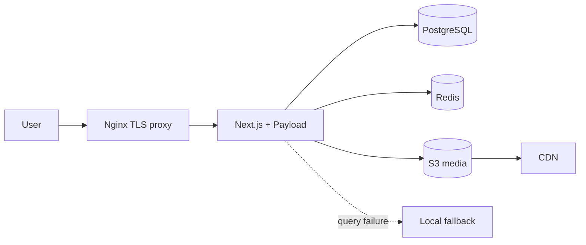

# LinuxUnity Cloud & DevOps Blog

Production bilingual publishing platform built with Next.js App Router, React, Payload CMS, PostgreSQL, Redis, Docker Compose, and Nginx. Vietnamese is the default locale; English is available under `/en`.

## Architecture and source of truth

Payload is authoritative whenever it is reachable and a query succeeds. Local content exists only as a development/build or outage fallback. A successful empty CMS result stays empty, so deleted CMS entities are never merged back from fallback files.



The homepage Team section reads the Payload `authors` collection directly. Creating an Author in `/admin` therefore adds that person to Team without a frontend code change.

## Requirements and local setup

- Node.js 24 and npm
- Docker Engine with Compose v2
- PostgreSQL and Redis
- Production: an S3 media bucket/CDN and an S3 backup location

```bash
cp .env.example .env
npm ci
npm run dev
```

Open `http://localhost:3000` and `http://localhost:3000/admin`. Configure `DATABASE_URL`, `PAYLOAD_SECRET`, PostgreSQL values, and OAuth values when testing comment login. With no `S3_MEDIA_BUCKET`, Payload keeps local storage for development; production should always configure S3.

Quality gates:

```bash
npm run lint
npm test
npm run build
```

## Media on S3 and CDN

The official `@payloadcms/storage-s3` adapter manages Payload uploads. Setting `S3_MEDIA_BUCKET` disables local media storage.

```dotenv
S3_MEDIA_BUCKET=linuxunity-media
S3_MEDIA_REGION=ap-southeast-1
S3_MEDIA_PREFIX=media
MEDIA_CDN_URL=https://cdn.example.com
```

Prefer an IAM role. Use `S3_MEDIA_ACCESS_KEY_ID` and `S3_MEDIA_SECRET_ACCESS_KEY` only where role credentials are unavailable. The CDN/bucket must serve public media reads; grant write/delete only to the app identity. Existing local uploads require a one-time object migration and URL verification before the old volume is removed.

## Why Compose is structured this way

Production `docker-compose.yml` has no app build instruction. `APP_IMAGE` must be an immutable ECR Git-SHA image built in CI, and the VPS runs:

```bash
docker compose pull app
docker compose up -d --remove-orphans --no-build
```

`docker-compose.build.yml` is the explicit local override:

```bash
docker compose -f docker-compose.yml -f docker-compose.build.yml build app
docker compose -f docker-compose.yml -f docker-compose.build.yml up -d
```

- `nginx`: TLS termination and routing; waits for app health.
- `app`: Next.js standalone server and Payload.
- `postgres`: authoritative CMS data on `payload_postgres_data`.
- `redis`: cache/rate-limit state on `redis_data`.
- `uptime-kuma`: monitoring data on `uptime_kuma_data`.
- permission services: initialize writable runtime/translation paths.

Media is absent from production volumes because it belongs in S3/CDN. This keeps deployments image-only and prevents VPS disk loss from deleting uploads.

## Why CI/CD is structured this way

`.github/workflows/deploy-production.yml` performs:

1. `verify`: lockfile install, lint, tests, and production Next build.
2. `build-and-push`: runs only after verify, builds the Docker `runner` target, and pushes `${GITHUB_SHA}` to ECR.
3. `deploy`: records the old image, uploads a pre-migration data backup to S3, pulls the exact SHA, and starts Compose with `--no-build`.
4. promotion: only a healthy deployment receives the movable `production` tag.

This ordering prevents unverified images entering deployment, keeps compilation off the VPS, makes rollback deterministic, and retains the prior image until health checks pass.

Required GitHub secrets: `AWS_ACCESS_KEY_ID`, `AWS_SECRET_ACCESS_KEY`, `AWS_DEFAULT_REGION`, `AWS_ECR_REGISTRY`, `AWS_ECR_REPOSITORY`, `VPS_HOST`, `VPS_USER`, `VPS_PORT`, `VPS_SSH_KEY`, `APP_DIR`, and `BACKUP_S3_URI`. Optional variable `BACKUP_S3_STORAGE_CLASS` defaults to `STANDARD_IA`.

## Backup and rollback

ECR protects application images only. `scripts/backup.sh` captures PostgreSQL, runtime JSON, Uptime Kuma, translation work, a manifest, and checksums, then requires an encrypted upload to `BACKUP_S3_URI`.

```bash
BACKUP_REASON=manual sh scripts/backup.sh
CONFIRM_ROLLBACK=yes sh scripts/rollback.sh image <ecr-sha-image>
CONFIRM_ROLLBACK=yes sh scripts/rollback.sh full ./backups/<timestamp>
```

Use S3 bucket versioning and lifecycle policies for media and backup retention. Image-only rollback never mutates data. Full rollback requires explicit confirmation and restores the image named by the backup manifest with its persistent data. Legacy archives containing `payload-media.tgz` remain readable; current media recovery uses S3 versioning/bucket recovery.

## Repository layout

```text
.github/workflows/   verification, ECR build, production deploy
content/             outage/development fallback content
data/                runtime JSON fallback stores
deploy/              Nginx and VPS assets
docs/                Markdown architecture and operations docs
scripts/             active import, translation, backup and deploy tools
src/                 application, Payload config, services and migrations
tests/               Node tests and actively referenced fixtures
```

## Operating rules

- Never build production on the VPS or use mutable application tags for deploy.
- Never treat ECR as database/media backup.
- Run off-host backups before Payload migrations.
- Preserve the Payload-first fallback model.
- Never commit `.env` or credentials.
- Use `feature/*`, `bugfix/*`, `hotfix/*`, or `codex/*`; `main` is production only.

See [docs/FEATURES.md](docs/FEATURES.md), [docs/CICD_DEPLOYMENT.md](docs/CICD_DEPLOYMENT.md), and the Markdown topology files under `docs/`.
