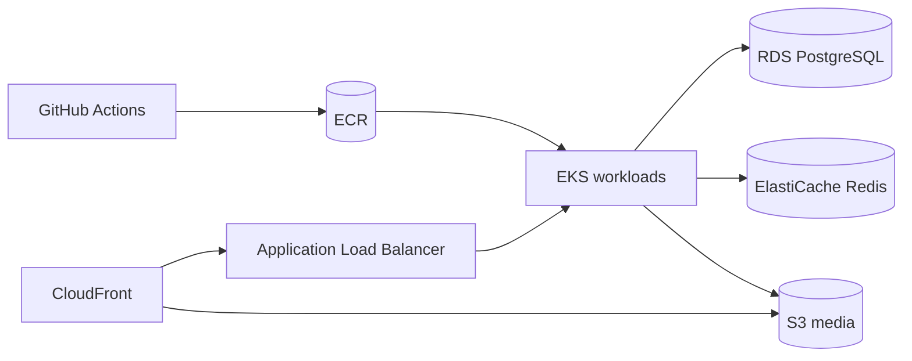

# Optional EKS evolution

This is an evolution option, not the active deployment. Moving to EKS requires managed database/cache decisions, workload identity, ingress, observability, and a tested data migration plan.
