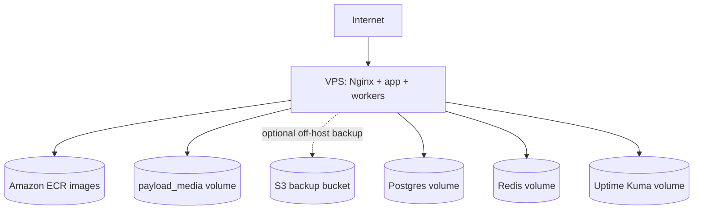

# AWS production topology

The current production target keeps compute, databases, and Payload media on the VPS. Pre-deploy backups include the media volume; an optional S3 backup target can move encrypted archives off-host when configured. ECR provides immutable application rollback artifacts.
