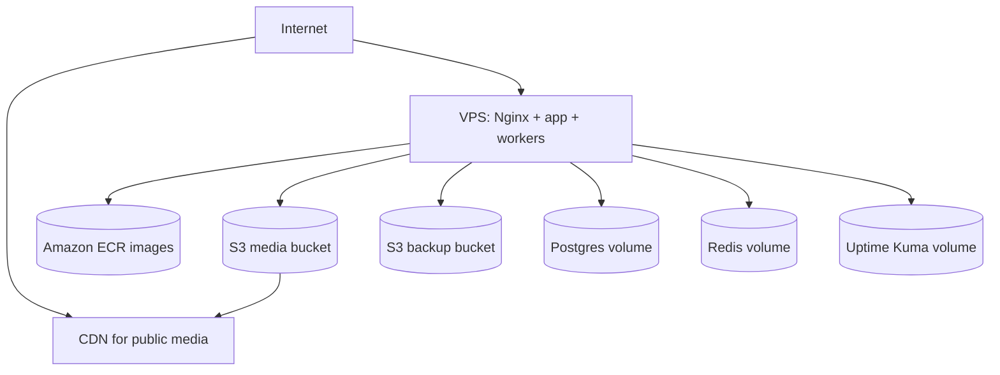

# AWS production topology

The current production target keeps compute and databases on the VPS. S3 removes uploaded media and backup durability from the VPS failure domain; ECR provides immutable application rollback artifacts.
