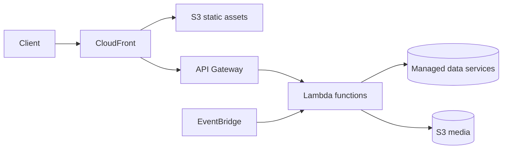

# Optional serverless workflow

This topology is architectural research only. The application remains Next.js, Payload CMS, Postgres, Redis, Docker Compose, and Nginx unless an explicit migration is approved.
