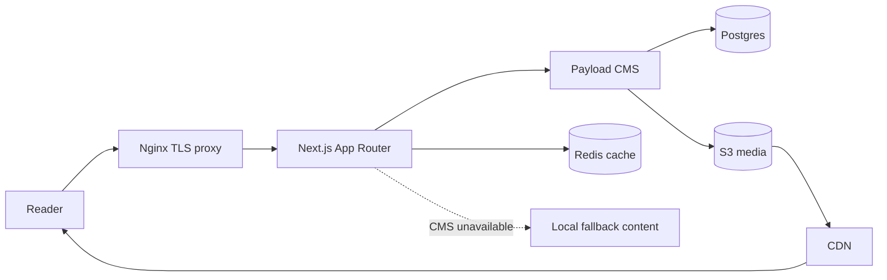

# Current website workflow

Payload is authoritative whenever its query succeeds. Local content is used only when Payload is unavailable or a query fails; an empty successful CMS result remains empty.
